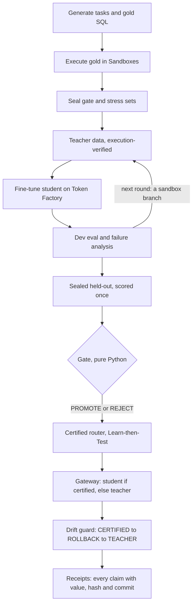

# Distillery

**Change one base URL and Distillery swaps your big model for a certified specialist that hands back anything it can't guarantee.**

Distillery is an autonomous agent that distils a narrow, repetitive job (today: text-to-SQL over a synthetic SQLite database) from a big Nemotron model into a small fine-tuned student (`Qwen/Qwen3-1.7B`, LoRA), then ships it behind an OpenAI-compatible gateway. The agent writes the SQL, runs and tests it in Nebius Sandboxes, fine-tunes on Token Factory, gates the result with a pure-Python test, and certifies a router that serves the student only where it can bound the error rate; everything else goes back to the teacher. A drift guard rolls the gateway back to the teacher on its own.

Track: Coding and Agentic Engineering (Nebius x NVIDIA Global AI Hackathon). Live demo: <https://distillery.onrender.com> · Source: <https://github.com/Auro-rium/distillery> (MIT).

> **Status (2026-10-22).** The agent loop, gate, certified router, drift guard, gateway and receipts page are built, and every claim in the Results table is backed by a file in `docs/proofs/evidence/`. The student PROMOTEd on templated questions and **does not pass the gate on naturally phrased ones** (Gate B and N1 are both REJECT). The certified router exists because of that: it serves the student only where the error rate is certified and defers the rest to the teacher. No dollar saving per request is claimed: the student's serving cost is not measured.

## What it does



- **Agent loop** (`orchestrator.py`, optional bounded Ultra controller `controller.py`, off by default): planner clusters dev failures into families, teacher writes SQL, only rows that execute correctly are kept, each round branches the sandbox into an experiment tree. Supervised, resumable, outage-aware (`server/worker.py`, `driver.py`).
- **Gate** (`gate.py`, `stats.py`): PROMOTE only if the paired-bootstrap lower bound of student/teacher accuracy is at least 0.85 and the student beats base by exact McNemar (alpha 0.05). No LLM in the gate. The held-out set is readable only by `evaluator.py` (AST-tested).
- **Certified router** (`router.py`, `router_data.py`, `router_eval.py`, `stats.certify`): a logistic score over three signals (execution OK, student mean log-prob, nearest-neighbour similarity to training questions via `Qwen/Qwen3-Embedding-8B`), with the serve-the-student threshold certified by Learn-then-Test on sealed CAL/TEST splits whose hashes and pre-registration commit are checked. Certified at alpha 0.08, delta 0.05, threshold λ̂ 0.917 on the calibration split (n=489) ([router_cert.json](docs/proofs/evidence/router_cert.json)).
- **Gateway** (`server/gateway.py`): the certified `acme-sql` skill is recognised by the sha256 of its system prompt; `distillery` extension in the response says who answered; every call is a `gateway_calls` row; savings are computed server-side. With no loaded certificate, every request goes to the teacher.
- **Acme analyst** (`acme.py`, `server/acme_api.py`, `scripts/acme_agent.py`): a plain `openai`-SDK agent. Pointing it at Token Factory or at the gateway differs only in `--base-url`.
- **Drift guard** (`drift.py`, `drift_sim.py`): deferral-rate and teacher-audit detectors; rollback is automatic, the way back is a new certificate (`recertify`); a re-distill is queued, never run automatically.
- **Money** (`global_ledger.py`, `budget.py`): one cross-process ledger, caps, preflight, paid jobs cancelled in `finally`.
- **Receipts** (`scripts/build_evidence.py`, `/receipts`, `GET /api/evidence`): one row per claim with value, commit-pinned artifact, pre-registration commit, sealed-set and adapter hashes, ledger total. Pending claims show no number.

## Results

Every number is copied from the file in the Source column. Student is `Qwen/Qwen3-1.7B` + LoRA; teacher is Nemotron 3 Super. Evidence directory: [docs/proofs/evidence](docs/proofs/evidence).

| ID | Claim | Result | Status | Source |
|---|---|---|---|---|
| P4 | Student promoted on a sealed templated held-out (n=300) | base 0.257, student 0.923, teacher 0.900; ratio lower bound 0.993 (bar 0.85); McNemar 202 vs 2; run cost $4.26. Stress set (n=100, not a gate input): student 0.16 | **PROMOTE**, in-distribution only (skeleton overlap with train 0.9467) | [p4_run_summary.json](docs/proofs/evidence/p4_run_summary.json) |
| A5 | Autonomy under injected faults, no human action | 8 injected faults, 4 supervisor restarts, 1 fine-tune job billed, verdict PROMOTE (lower bound 1.022), spend $4.1918 | **PASS** (5/5 criteria) | [a5_chaos.json](docs/proofs/evidence/a5_chaos.json) |
| B2 | Student beats a fair (8-shot Super) teacher | student 0.9233 vs 0.9333; ratio lower bound 0.957 (claim needs > 1.0) | **no claim made** | [b2_fair_teacher_s0_s1.json](docs/proofs/evidence/b2_fair_teacher_s0_s1.json) |
| Gate B | Student holds up on 86 natural, agent-authored questions | base 0.384, student 0.407; ratio lower bound 0.306; McNemar p 0.84 (teacher 0.988 is inflated: it drafted the gold) | **REJECT** | [gateb_agent_authored.json](docs/proofs/evidence/gateb_agent_authored.json) |
| N1 | Training on natural phrasing closes the gap (fresh agent-authored set, n=98) | base 0.296, student 0.571, teacher 0.959; ratio lower bound 0.495 < 0.85; McNemar p 4.6e-07 | **REJECT** (better than base, short of the bar) | [n1_natural_round.json](docs/proofs/evidence/n1_natural_round.json) |
| W-C1 | Certified router: selective error within alpha at minimum coverage, system accuracy not below teacher-only | sealed test n=490: student served 240 (coverage 0.490, minimum 0.30) with 10 wrong (selective error 0.042, 95% upper bound 0.070, alpha 0.08); system accuracy 0.951 vs teacher-only 0.935 | **PASS** (all 3 pre-registered clauses) | [router_eval_test.json](docs/proofs/evidence/router_eval_test.json) |
| W-C2 | Router defers most wrong student answers, few right ones | natural + stress test items: 115 of 117 wrong student answers deferred (0.983, lower 95% bound 0.947, minimum 0.80); but 113 of 123 right answers were deferred too (0.919), so on this traffic the router mostly hands everything to the teacher | **PASS** (both clauses; separation is small) | [router_eval_test.json](docs/proofs/evidence/router_eval_test.json) |
| W-D | Drift burst trips the guard and rolls back to the teacher | 30 off-distribution questions (a new `credit_grants` table) after 200 test requests: rollback on burst request 13 (limit 25), 0 false alarms before it, 0 wrong student answers during the burst; the router defers each of the 30 distinct burst questions (the student would have got 11 right). Over 300 seeds: 295 pass (5 false alarms before the burst), median rollback at request 15 | **PASS** (all 3 pre-registered clauses) | [drift_burst.json](docs/proofs/evidence/drift_burst.json), [h3_drift_report.json](docs/proofs/evidence/h3_drift_report.json), [h3_burst_counts.json](docs/proofs/evidence/h3_burst_counts.json) |
| W-E2E (hosted) | The same live check against the deployed service (normal phase only, so the public gateway is not rolled back on purpose) | Render service at commit `e09c606`, 2026-10-22: 12 of 20 normal questions served by the student (all verified), 8 deferred to the teacher, no 5xx; `scripts/smoke_live.py` 18/18 checks passed | **PASS** (C1–C4) | [w_e2e_hosted.json](docs/proofs/evidence/w_e2e_hosted.json) |
| W-G | An unchanged agent works against the gateway after one base-URL change | same agent code, base URL swapped; test passes | verified as a test | [tests/test_acme_wg.py](tests/test_acme_wg.py) |
| W-E2E | Live end to end: certified router, student, deferral, drift guard | Live local server on Token Factory + Nebius Sandbox, pinned N1 checkpoint: 12 of 20 normal questions served by the student (all 12 verified; 12 of the 14 templated ones), 8 deferred by the router (all 6 of the website's example questions); 30-question burst: rollback on burst request 14 (limit 25), 0 student answers during or after it; student answers took a median 39 s (max 73 s) on sandbox CPU; spend $0.0331 | **PASS** (all 6 pre-registered criteria) | [w_e2e.json](docs/proofs/evidence/w_e2e.json) |

Spend to date (global ledger; sandbox is recorded at $0, so this is a lower bound): $15.2583 of the 19.50 cap, plus $1.50 reserved for hosting the demo ([DECISIONS.md](DECISIONS.md)). Claims, procedures and pre-registrations: [DECISIONS.md](DECISIONS.md).

## How we use Nemotron

| Role | Model id | Job |
|---|---|---|
| Planner | `nvidia/Nemotron-3-Ultra-550b-a55b` (Nemotron 3 Ultra) | clusters dev failures into task families; optional bounded controller |
| Teacher | `nvidia/nemotron-3-super-120b-a12b` (Nemotron 3 Super) | writes training SQL; scored as the ceiling; at runtime it answers every request the router defers |
| Triage | `nvidia/NVIDIA-Nemotron-3-Nano-30B-A3B` (Nemotron 3 Nano) | format triage; one-line summaries in the Acme analyst; the only public passthrough model |

Nemotron is not fine-tunable on Token Factory, so it is the engineer and the teacher, and the student is `Qwen/Qwen3-1.7B` + LoRA. Ids are set in [render.yaml](render.yaml) and read through `DISTILLERY_MODEL_PLANNER|TEACHER|TRIAGE|STUDENT`; prices in [deploy/prices.json](deploy/prices.json).

**Measured cost split in the P4 run** ([p4_run_summary.json](docs/proofs/evidence/p4_run_summary.json); estimates from measured tokens x the API's listed price, not billed amounts): Super 2,638 calls, $1.7328; Nano 684 calls, $0.1883; fine-tune $2.3370; run total $4.2582.

## Where Token Factory accelerated us

- **Fine-tuning API:** the whole student training step is one API job. P4 trained Qwen3-1.7B for 1,488 steps on 5.84M tokens for $2.3370 (billed basis); the job object exposes resolved hyperparameters, per-step loss and downloadable checkpoints, which we SHA-256-check before scoring. A job survived a SIGKILL of our process and was adopted again by id instead of being bought twice ([a5_chaos.json](docs/proofs/evidence/a5_chaos.json)).
- **Sandboxes:** every gold query, training row and evaluation is executed there, and branching is the experiment tree. The base and student models are also served from sandbox CPU, which is what the live demo uses.
- **Structured output:** `json_schema` with `strict: true` worked on the first try on Nano, Super and Ultra, for the planner and triage objects the orchestrator parses.
- **OpenAI-compatible inference:** the plain `openai` SDK works unchanged; the Acme analyst differs between Token Factory and our gateway only in `--base-url`.
- **Embeddings:** `Qwen/Qwen3-Embedding-8B` supplies the router's nearest-neighbour signal.

Friction and findings: [FEEDBACK.md](FEEDBACK.md).

## Nebius services used

- **Token Factory inference** (Nemotron 3 Ultra, Super, Nano; `json_schema` strict mode).
- **Token Factory fine-tuning** (LoRA on Qwen3-1.7B: the P4, A5 and N1 runs).
- **Token Factory Sandboxes** (execution, verification, branching, CPU serving of base and student).
- **Token Factory embeddings** (`Qwen/Qwen3-Embedding-8B`).

## Quickstart

Requirements: Python 3.12 or newer with [uv](https://docs.astral.sh/uv/), and Node.js with npm for the frontend.

```bash
git clone https://github.com/Auro-rium/distillery && cd distillery
uv sync --extra dev
cp .env.example .env     # fill in; .env is gitignored
(cd frontend && npm install)
```

Variables in `.env.example` (names only): `NEBIUS_API_KEY`, `NEBIUS_BASE_URL`, `NEBIUS_AI_PROJECT`, `DISTILLERY_SANDBOX_URL`, `DISTILLERY_SANDBOX_IMAGE`, `DISTILLERY_ADMIN_TOKEN`, `DISTILLERY_RUN_CAP_USD`, `DISTILLERY_PROJECT_CAP_USD`, `DISTILLERY_PLAYGROUND_DAILY_CAP_USD`, `DISTILLERY_PRICES_FILE`, `DISTILLERY_MODEL_PLANNER`, `DISTILLERY_MODEL_TEACHER`, `DISTILLERY_MODEL_TRIAGE`, `DISTILLERY_MODEL_STUDENT`, `DISTILLERY_HOME`, `DISTILLERY_REPLAY_DIR`, `DISTILLERY_ALLOWED_ORIGINS`, `DISTILLERY_SEED`. Gateway, router and drift settings are in [docs/API_CONTRACT.md](docs/API_CONTRACT.md).

Free, offline (fake models, fake prices, labelled "DRY RUN"; proves plumbing, not quality):

```bash
uv run python -m distillery run --pack sql --scale tiny --dry-run
uv run python -m distillery serve --port 8000        # API + replay; with `make dev`, the Vite UI too
uv run python -m pytest -q -p no:cacheprovider      # 1266 tests passed on 2026-10-22; all offline, no key needed
uv run python -m distillery ledger status             # spend ledger
uv run python scripts/build_evidence.py --out /tmp/evidence.json   # rebuild the receipts, free
```

Paid or certified steps (all need `--i-approve-spend` / an admin token; read `--help` first): `run --scale gated`, `router build-splits | signals | fit | certify | evaluate`, `scripts/acme_agent.py --base-url <url>`. Container: `make docker`, then `docker run --rm -p 8000:8000 --env-file .env distillery:local` (without a key it starts in replay-only mode). Hosting notes: [docs/DEPLOY.md](docs/DEPLOY.md).

## For judges

- **Demo:** <https://distillery.onrender.com> (free, no sign-in; the free host sleeps when idle, so the first request can take about a minute).
- **Click, in order:** **Mission** (landing page: how it works, the proof ladder, stored runs), then **Evidence** (the featured recorded run's report: gate statistics, held-out and stress charts; the experiment tree is linked from the run); **Acme analyst** (`/playground`: ask a question, see who answered, the confidence against the threshold, SQL, rows, cost, the savings counter, the drift panel); **Receipts** (`/receipts`: every claim, its value, artifact link, hashes; pending claims show no number).
- **Live vs replay:** stored runs are recorded real runs (banner "Recorded run · <time> · real Token Factory jobs"); a dry-run sample carries the banner "DRY RUN — fake models, numbers are NOT results". The Acme analyst and gateway are live requests, capped per address and per day. With no certificate loaded the gateway says "Not certified yet: all traffic goes to the teacher" and sends everything to the teacher. New runs are locked on the public demo.
- **Public repo and license:** MIT, [LICENSE](LICENSE). Repo: <https://github.com/Auro-rium/distillery>.
- **Lineage:** an earlier AWS-based prototype (Aug 2026) never completed an end-to-end run; Distillery is a from-scratch rebuild started Sep 29, 2026 on Nebius, and no code was carried over.

## Limitations

- **The win is in-distribution.** P4 PROMOTEd on templated questions (skeleton overlap with train 0.9467, [p4_run_summary.json](docs/proofs/evidence/p4_run_summary.json)); Gate B and N1 are REJECT. The N1 and Gate B sets are agent-authored (a Claude subagent), not human-written, and their teacher accuracy is inflated by construction.
- **Toy database:** a synthetic schema with templated gold. Results say little about real-world text-to-SQL. One task pack ships (`sql`); a `toolcall` pack has only a dry-run record ([c3_toolcall_dry_run.json](docs/proofs/evidence/c3_toolcall_dry_run.json)).
- **Student serving is slow today:** sandbox CPU, with a per-day student call cap in the gateway, and sandbox time is unpriced, so no student cost per request is claimed.
- **One run, one seed** for each result; small sealed sets (n=300, 98, 86) give wide intervals.
- **Hosted on a free Render plan** (sleeps, ephemeral disk; see [docs/DEPLOY.md](docs/DEPLOY.md)); the autonomy claim is bounded to one instance lifetime.
- **Streaming and tool-calling are not supported** on the gateway (`400`).

## License

MIT. See [LICENSE](LICENSE).
