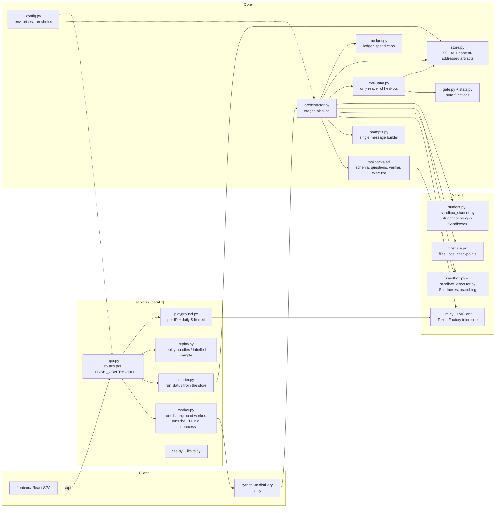
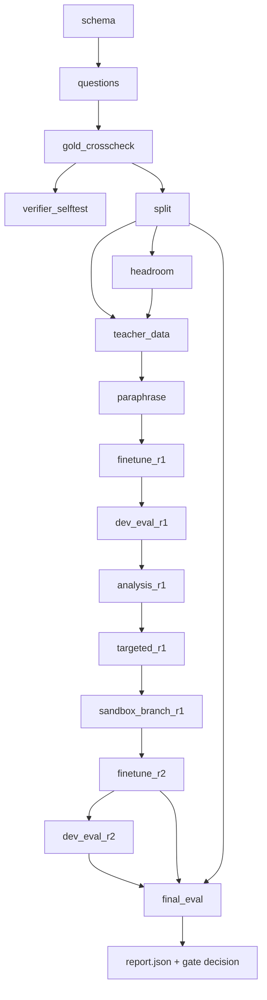
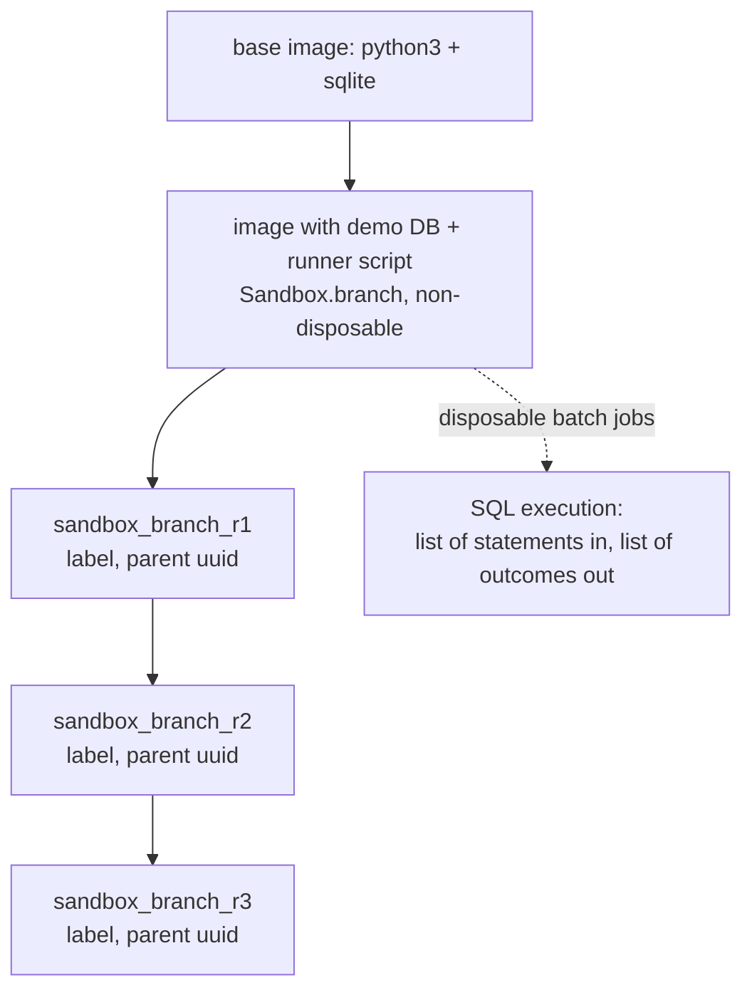
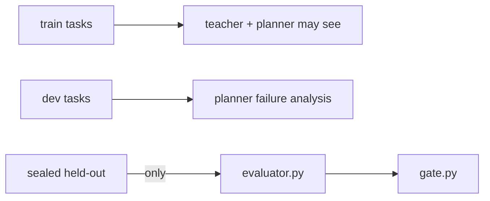

# Architecture

Describes what exists under `src/distillery` today. Statuses: "offline-tested" means unit-tested with fakes; "UNVERIFIED" means never run against the real service. Results and their status are in [README.md](../README.md) (do not read a number out of this file).

## System overview

One agent produces a certified specialist; one gateway delivers it; one guard and one ledger keep it honest. `[live]` = exercised against real services and recorded in `docs/proofs/evidence/`; `[offline]` = built and unit-tested with fakes, measured result pending.

```
                         BUILD (agent loop, python -m distillery run)            [live: P4, A5, N1]
 planner (Nemotron Ultra) --families--> teacher (Nemotron Super) --SQL--> Sandboxes (execute, verify, branch)
        ^                                        |  verified rows only           |
        |                                        v                               v
   dev failures <--- dev eval <--- fine-tune student (Token Factory, Qwen3-1.7B LoRA)   store.py (SQLite + sealed sets)
                                         |
                                         v
                 sealed held-out, scored once --> gate.py (pure Python) --> PROMOTE / REJECT   [live]
                                         |
                         CERTIFY (python -m distillery router ...)              [offline: W-C1, W-C2 pending]
 sealed FIT / CAL / TEST splits -> signals (exec_ok, mean log-prob, nn_sim via Qwen3-Embedding-8B)
   -> router.py logistic score -> stats.certify (Learn-then-Test) -> model.json + cert.json
                                         |
                              SERVE (server/gateway.py)                         [live: W-E2E PASS]   
 client (openai SDK, only base_url changed) --POST /v1/chat/completions--> skill detection (system-prompt sha256)
   -> embed question -> router.precheck -> student (Sandbox CPU / AI Cloud H1) -> run SQL read-only -> router.decide
        served iff certified score >= lambda  --> student answer
        otherwise                              --> teacher (Nemotron Super), reason returned in `distillery`
   every call -> gateway_calls row -> /api/gateway/savings, /api/gateway/status
                                         |
                      WATCH (drift.py)                                          [offline: W-D pending]
 deferral-rate + teacher-audit detectors: CERTIFIED -> ROLLBACK -> TEACHER; recertify needs a NEW cert; re-distill queued
                                         |
                      PROVE (scripts/build_evidence.py -> deploy/evidence.json -> /receipts, global_ledger.py)
```

## Components (core pipeline; the system overview above adds the router, gateway, drift guard, ledger and receipts)



Notes tied to the code:

- The API never runs the pipeline in-process. `worker.py` starts `python -m distillery run` as a subprocess (one at a time; a second live run gets 409) and streams its output to SSE.
- `pipeline_fakes.py` holds the deterministic fakes used by `--dry-run` and tests; dry runs use a separate store root and a `dry-` run id prefix.
- The student and the un-tuned base are served on CPU with peft inside Nebius Sandboxes (`sandbox_student.py`, `student_serving="sandbox_cpu"` on the live path). `student.py` holds the interface.
- `LLMClient` routes by role (planner, teacher, triage, student), classifies retries, handles `json_schema` structured output, splits reasoning from content, and logs usage into the budget ledger.

## Pipeline stages

Stage names are the ones in `orchestrator.py`; `r` is the round number. Each stage is cached in the store by input hash, so a killed run resumes.



- `gold_crosscheck` no longer involves any model: it executes every template gold in the executor and accepts a task if it runs and returns rows (the name and the `accepted` key are kept for later stages and the UI).
- `split` seals the in-distribution gate set (Gate A), the separate stress set and, when `--human-set` is given, the confirmed natural-question set (Gate B, agent-authored); the store refuses to hand any of them out except to `evaluator.py`. The natural-question set is drafted and confirmed offline (`draft-heldout`, `confirm-heldout`), never by the pipeline; the sets used so far are agent-authored and are never called human-written.
- `paraphrase` has Nano paraphrase verified train questions (train text only); a paraphrase becomes a training row only if the teacher's SQL executes to the original template gold. Verified originals are kept first and paraphrases fill up to `train_row_cap` (2,000).
- `headroom` scores the base student on dev and raises `TaskTooEasyError` if accuracy is at or above the threshold (default 0.80).
- `final_eval` evaluates only the round with the best DEV accuracy, verifies the adapter SHA-256 against the fine-tune job's, scores base, student and teacher on the same held-out items in the same order, and calls the gate twice with the same thresholds (Gate A on the template set, Gate B on the natural-question set). The stress set is scored afterwards and is never a gate input.
- Later rounds repeat `analysis`, `targeted`, `sandbox_branch` and `finetune` up to `max_rounds` (CLI default 3; the pre-registered gated run uses `--max-rounds 1`, so those stages do not run in it).

## Sandbox branching tree



`Sandbox.lineage()` returns `(uuid, parent_uuid, label)` tuples. `GET /api/runs/{id}/tree` joins that lineage with per-round metrics from the report and never invents nodes. Branching ran in the two-round smoke runs (`replay/sql-mini-live1/tree.json`); the gated runs P4 and N1 use one round (`max_rounds=1`), so they have no branch beyond the seed. Output truncation and image-content behaviour were not separately verified; the fake sandbox reproduces the lineage semantics for tests.

## Data integrity boundaries



## Certified router

Module map (all offline-tested; no certificate exists yet, so W-C1 and W-C2 are pending):

- `router_data.py`: the FIT / CAL / TEST splits. FIT is the items already sealed for the N1 run plus confirmed human files, read only through `evaluator.py`. CAL and TEST are fresh draws (templated, natural, stress mix), sealed like the held-out set (`Store.seal_router_split`), with exact-text overlap against every earlier set dropped and counted. `compute_signals` turns items into per-item rows (signals, correctness, hashes) with the student, executor, teacher and embedder injected.
- `embed_index.py`: `EmbeddingIndex`, the `nn_sim` signal (maximum cosine similarity to the training questions) from `Qwen/Qwen3-Embedding-8B`, truncated to 1024 of 4096 dimensions and re-normalised; cached by a content hash of model, dims and texts.
- `router.py`: `RouterModel`, a logistic score over `exec_ok`, `mean_logprob`, `nn_sim` fitted on FIT only; `decide` (serve the student iff score reaches the certified threshold, with a reason naming the weakest feature) and `precheck` (skip the student when even its best case cannot reach the threshold).
- `stats.py`: `certify`, the Learn-then-Test fixed-sequence test over a coverage grid fixed from FIT; the result is `lambda_hat` (or none, meaning everything goes to the teacher).
- `router_eval.py`: fit, certify, the one-shot TEST evaluation (W-C1, W-C2) and `verify_prereg`, which refuses to run unless the pre-registration commit is an ancestor of HEAD and contains the sealed split hashes.
- `router_cmd.py`: `python -m distillery router build-splits | signals | fit | certify | evaluate`. Artifacts under `<run>/router/`: `splits.json`, `signals_<split>.json`, `model.json`, `cert.json`, `eval_test.json`.

## Gateway and Acme analyst

- `server/gateway.py` (+ `server/gateway_config.py`): `POST /v1/chat/completions`, OpenAI-shaped. The certified `acme-sql` skill is detected by exact request shape (model is the teacher id, `[system, user]`, system prompt sha256, user content parsed back by `prompts.parse_user_content`). Skill requests run embed, `precheck`, student, read-only execution, `decide`; the teacher answers anything not served by the student. Other requests are allowlisted passthrough with clamped `max_tokens`. Per-address and daily-dollar limits, a daily student-call cap, and one `gateway_calls` row per call (`store.py`). Savings are computed server-side from that table. Router artifacts load from `DISTILLERY_ROUTER_DIR`; without a certificate every request goes to the teacher.
- `acme.py`: `AcmeAnalyst`, an agent that uses only the `openai` SDK; `scripts/acme_agent.py --base-url <url>` runs it against Token Factory or the gateway, and `server/acme_api.py` runs the same two calls server-side for the website (`POST /api/acme/ask`), delivered to the gateway in-process so limits and logging are identical to a customer's. Contract: [API_CONTRACT.md](API_CONTRACT.md).

## Drift guard

`drift.py` is a pure, deterministic state machine (`CERTIFIED -> ROLLBACK -> TEACHER`); `ROLLBACK` is the transition instant and the steady state is `TEACHER`. Two detectors: the deferral share over a window, and disagreements among audited student answers (audit selection is a hash of the request id). Recertifying needs a new certificate and a pre-registration commit. A rollback also writes a `redistill_queued` event; nothing re-distils automatically. Transitions persist in `drift_events` (`store.py`) and are restored at startup. `drift_sim.py` + `scripts/drift_sim.py` calibrate `tau` and replay a burst on recorded rows (free); W-D is pending.

## Global ledger

`global_ledger.py` is one SQLite file (`DISTILLERY_GLOBAL_LEDGER`) shared by every store copy and process; spend rows plus reservations, every check-and-write inside `BEGIN IMMEDIATE`. `budget.py` preflights against it; `python -m distillery ledger status | seed`. The hosted Render service turns it off (ephemeral disk) and relies on the daily caps ([DEPLOY.md](DEPLOY.md)).

## Receipts

`scripts/build_evidence.py` reads `docs/proofs/evidence/*.json` (it knows keys, not values) and writes `deploy/evidence.json`: the proof ladder plus one `receipts` row per claim. A claim whose evidence file does not exist is `pending` with no value. `server/evidence.py` serves it at `GET /api/evidence`; the frontend renders `/receipts`.

## H1 serving-cost harness

`aicloud_endpoint.py` builds and runs the `nebius ai endpoint ...` commands for one time-boxed L40S vLLM + LoRA endpoint through an injected command runner, always deletes it in `finally` and confirms via `list`; `h1_measure.py` measures throughput, latency and parity with the sandbox student and does the cost and break-even arithmetic (projections are labelled); `scripts/h1_endpoint.py --plan-only` prints the plan without spending. Offline-tested; not run live (W-$ pending). Until `deploy/serving_price.json` exists the savings counter reports the student cost as "pending H1".

## Other modules

`controller.py` (optional Ultra controller under pre-registered bounds, off by default), `fairteacher.py` (B2), `humanset.py` / `humanscore.py` / `naturaltrain.py` (Gate B and N1 data and scoring), `driver.py` + `chaos.py` + `server/watchdog.py` + `server/autonomy.py` (unattended runs, fault injection), `costing.py` / `reprice.py` (cost accounting), `taskpacks/sql` and `taskpacks/toolcall` (the toolcall pack has only a dry-run record).

## Deploy

One container: the API plus `frontend/dist` (see `Dockerfile`), deployed as a single Render web service (`render.yaml`, see `docs/DEPLOY.md`); inference, fine-tuning, embeddings and sandbox work run on Nebius Token Factory. The H1 harness is the only part that targets Nebius AI Cloud, and it is a measurement run, not hosting.
